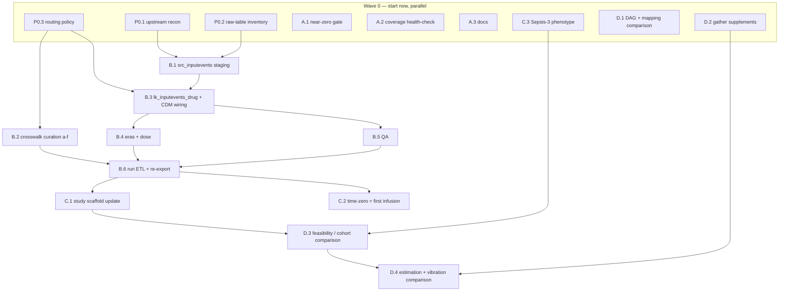

# Work plan — MIMIC-IV → OMOP coverage + albumin/sepsis comparison

Task breakdown for parallel agent work. The goal is twofold and the two
reinforce each other:

1. **Make the MIMIC-IV OMOP build usable for general ICU causal questions**,
   not just prescription-ordered drugs — the gap is that the OHDSI/MIMIC ETL
   never ingests `inputevents` (ICU infusions), so fluids, vasopressors,
   sedation, IV insulin and blood products are absent or order-only. See
   `studies/albumin_sepsis_28d/reference_paper_extraction.md` §9a for the
   verified findings.
2. **Run the CausalOMOP pipeline against Doutreligne et al. 2025**
   (`doi:10.1371/journal.pdig.0000721`) as the validation vehicle. Ground
   truth is in `reference_paper_extraction.md`.

Two repositories are involved:

- **`CausalOMOP`** (this repo, `main`) — audit hardening, phenotypes, the
  comparison. Workstreams A, C, D.
- **`external/ohdsi_mimic`** (submodule → `ji-ch01/MIMIC` fork) — the ETL
  extension. Workstream B. Fully independent checkout; no file overlap with
  CausalOMOP.

---

## Dependency graph

---

## Workstream 0 — Recon & decisions (blocks Workstream B)

### P0.1 — Upstream reuse check
- **Goal:** does OHDSI/MIMIC (or any fork / the older MIT-LCP `mimic-omop`)
  already map `inputevents` → `drug_exposure`? Any open issue, PR, or branch?
- **Do:** search OHDSI/MIMIC issues + branches, `MIT-LCP/mimic-omop`,
  OHDSI forums. Read `external/ohdsi_mimic/MIMIC-IV_Scope_Approach.pdf` for
  the documented scope rationale (inputevents was likely deliberately
  excluded because rate/dose semantics are hard).
- **Output:** short memo `docs/notes/inputevents_upstream_recon.md` — what
  exists, what is reusable, go/no-go on building from scratch.
- **Repo:** read-only / web. **Size:** ~2 h. **Agent:** Explore or
  general-purpose with web.

### P0.2 — Raw-table inventory (needs BigQuery access)
- **Goal:** is `mimiciv_icu.inputevents` already loaded in the BQ project? What
  staging/CDM datasets and tables exist now? Is `d_items` (with `linksto`,
  `category`) present?
- **Output:** inventory table + a load plan if `inputevents` raw is missing
  (source: `physionet-data.mimiciv_icu.inputevents`, ~9.8M rows / ~2 GB).
- **Repo:** none (BQ). **Size:** ~1 h. **Owner:** user, or user-supervised
  agent with BQ creds.

### P0.3 — Routing policy (human decision, agent drafts)
- **Goal:** for every `d_items` category with `linksto = 'inputevents'`
  (Fluids, Medications, Blood Products, Nutrition – Enteral/Parenteral, …),
  decide the target OMOP table: `drug_exposure` / `measurement` /
  `procedure_occurrence` / `observation` / out-of-scope.
- **Notes:** blood products are commonly `procedure_occurrence`; "OR
  Crystalloid Intake" / totals are I/O balance (`measurement`); enteral
  nutrition is often `observation`. Drugs and IV fluids → `drug_exposure`.
- **Output:** `external/ohdsi_mimic/z_more/inputevents_routing_policy.md` —
  category → destination → in/out, with rationale.
- **Size:** ~3 h draft + review. **Agent drafts, human signs off.**

---

## Workstream A — CausalOMOP audit hardening (Layer 0, independent, start now)

All in `CausalOMOP` `main`. Low mutual collision; **A.1 owns
`workflow.py`, A.2 owns the `causal/mapping/audit.py` additions + `cli.py`,
A.3 owns the doc** — keep those boundaries.

### A.1 — Near-zero-rows mapping gate
- **Problem:** `_check_mapping_coverage` (`causal/orchestrator/workflow.py`,
  `_MAPPING_COVERAGE_MIN_EVIDENCE_ROWS = 50`) stays silent when a role
  resolves to `< 50` total evidence rows, so a concept that is entirely
  absent from this ETL build (e.g. albumin, IV insulin, lactated ringers —
  all `inputevents`-only) produces a tiny cohort with no explanation.
- **Do:** add a distinct check — when a treatment/population/outcome role
  resolves to ~0 mapped rows AND the concept looks like it *should* be
  common (heuristic: drug ingredient with many descendants, or a condition
  with a high expected prevalence), raise a clear "likely absent from this
  OMOP build's ETL (ICU infusions from `inputevents` are not loaded)"
  message instead of proceeding.
- **Files:** `causal/orchestrator/workflow.py`, `tests/test_workflow.py`.
- **Size:** ~half day. **Agent:** yes, crisp.

### A.2 — Dataset coverage health-check command
- **Goal:** one command to run *before* building a study — "which of these
  drugs/conditions/labs are usable in this OMOP build, and are the drugs
  order-only or administration-backed?"
- **Do:** `python -m causal.cli mapping-coverage --probe configs/coverage_probe.yaml`
  (or `preflight --drug-coverage`). For each `{term, domain}`: resolve
  candidate concept_ids (reuse `BigQueryOMOPGateway.search_concepts` /
  `search_used_concepts`), run `causal.mapping.audit` coverage + row/person
  counts, and report the `drug_type_concept_id` distribution as an
  "order-only vs administration" flag.
- **Files:** `causal/cli.py`, `causal/mapping/audit.py` (+1–2 helpers),
  `causal/bigquery.py` (maybe), `configs/coverage_probe.yaml` (default probe
  list: aspirin, metformin, warfarin, norepinephrine, propofol, insulin,
  albumin, lactated ringers, sepsis, AKI, lactate, creatinine),
  `tests/test_mapping_audit.py`.
- **Size:** ~1 day. **Agent:** yes.

### A.3 — Documentation
- **Do:** update `docs/vocabulary_mapping_coverage.md` — correct the drug
  unmapped rate (3.2 %, not the inverted figure), add the order-vs-
  administration distinction, the `inputevents`-absent finding, and a "how
  to re-audit" runbook pointing at A.2.
- **Files:** `docs/vocabulary_mapping_coverage.md`.
- **Size:** ~2 h. **Agent:** yes, small.

---

## Workstream B — `inputevents` ETL (in `ji-ch01/MIMIC` fork)

All in `external/ohdsi_mimic`. Needs Workstream 0 done. Model everything on
the existing `prescriptions` path.

### B.1 — `src_inputevents` staging
- **Do:** add `CREATE OR REPLACE TABLE ... src_inputevents` to
  `etl/staging/st_icu.sql` (model on `src_procedureevents` / `src_chartevents`);
  register it in `conf/workflow_staging.conf` and
  `conf/workflow_staging_mimic22.conf`.
- **Files:** `etl/staging/st_icu.sql`, 2 staging confs.
- **Size:** ~3 h. **Depends:** P0.2.

### B.2 — Crosswalk curation (critical path, split by drug family)
- **State:** `crosswalk_csv/d_items_to_concept.csv` already has **474
  `linksto = inputevents` rows, all with an empty `target_concept_id`**.
  Fill `target_concept_id`, `target_vocabulary_id`, `target_concept_name`,
  `target_standard_concept` for the in-scope drug/fluid rows.
- **Per row, verify:** the concept exists in the *loaded* `CONCEPT` table,
  `standard_concept = 'S'`, correct ingredient (RxNorm Ingredient or a
  Clinical Drug of the right strength), Drug domain. Prefer ingredient-level
  unless dose_era needs strength.
- **CSV caveat:** several labels contain embedded commas inside quotes
  (`"Saline 0.9%"` split as `"Saline 0` | ...) — parse with a real CSV
  reader, not `awk -F,`.
- **Sub-packages (parallel branches, each merged after review):**
  | ID | Family | ~items |
  |---|---|---|
  | B.2a | Fluids & colloids — saline (all %), dextrose (all %), LR, Ringers acetate, albumin 4/5/20/25 %, hetastarch, mannitol, sodium bicarbonate | ~45 |
  | B.2b | Vasopressors & inotropes — norepinephrine, epinephrine, phenylephrine, vasopressin, dopamine, dobutamine, milrinone, isoproterenol, angiotensin II | ~15 |
  | B.2c | Sedation / analgesia / paralytics — propofol, midazolam, lorazepam, dexmedetomidine, fentanyl, morphine, hydromorphone, ketamine, cisatracurium, vecuronium, rocuronium | ~20 |
  | B.2d | Insulin & endocrine — insulin (regular/drip), hydrocortisone, dextrose 50 % (hypoglycaemia), calcium gluconate/chloride | ~12 |
  | B.2e | Blood products — PRBC, FFP, platelets, cryoprecipitate (route per P0.3 — likely `procedure_occurrence`, so may be a note not a mapping) | ~10 |
  | B.2f | Electrolytes / nutrition / misc — KCl, magnesium sulfate, phosphate, heparin, TPN, lipids, sodium phosphate; decision-heavy | ~30 |
- **Output per family:** filled CSV rows + a rationale sheet
  (`z_more/inputevents_mapping_rationale_<family>.md`).
- **Size:** ~3–5 h each. **Agent drafts + human review gate per family**
  (same governance as CausalOMOP: never promote a text match to an executable
  concept without review).

### B.3 — Lookup + CDM wiring
- **Do:** new `etl/etl/lk_inputevents_drug.sql` — clean `src_inputevents`,
  join the crosswalk, derive `quantity` from `amount`/`amountuom`, an
  end datetime from `endtime`, `drug_type_concept_id` = *EHR administration
  record* (confirm the concept id used elsewhere), `route_concept_id` = IV.
  UNION its output into `etl/etl/cdm_drug_exposure.sql`. Register in
  `conf/workflow_etl.conf` right before `cdm_drug_exposure.sql`.
- **Files:** new `lk_inputevents_drug.sql`, `cdm_drug_exposure.sql`,
  `conf/workflow_etl.conf`, maybe `etl/etl/ext_d_itemid_to_concept.sql`.
- **Size:** ~1 day. **Depends:** B.1 + P0.3. Can build against a stubbed
  crosswalk before B.2 is fully merged.

### B.4 — Eras & dose
- **Do:** confirm `cdm_drug_era.sql` and `cdm_dose_era.sql` handle the new
  rows. `dose_era` needs `drug_strength` coverage for the new concepts —
  add if missing or accept dose_era gaps for infusions.
- **Files:** `etl/etl/cdm_drug_era.sql`, `etl/etl/cdm_dose_era.sql`.
- **Size:** ~half day. **Depends:** B.3.

### B.5 — QA
- **Do:** row counts before/after per `unit_id`; spot-check ~20 patients'
  albumin and norepinephrine against raw `inputevents`; compare aggregate
  first-day fluid volume and vasopressor-days to MIMIC-Code
  `mimiciv_derived` (`vasoactive_agent`, `first_day_*`); run `test/qa` and
  `test/ut`.
- **Output:** `z_more/inputevents_qa_report.md`.
- **Size:** ~1 day. **Depends:** B.3 (+ B.4 for eras).

### B.6 — Run & re-export (user, BigQuery)
- **Do:** `python scripts/run_workflow.py -e conf/mimic22.etlconf` for the
  targeted chain only — staging(ICU) → `lk_drug` → `lk_inputevents_drug` →
  `cdm_drug_exposure` → `cdm_drug_era` → `cdm_dose_era` →
  `ext_d_itemid_to_concept`. Then from `CausalOMOP`:
  `python -m scripts.bigquery_etl.export_duckdb data/mimiciv_omop.duckdb --overwrite --tables drug_exposure drug_era dose_era`.
- **Size:** ~20–45 min compute + monitoring. **Depends:** B.2 (all) + B.4 + B.5.

---

## Workstream C — CausalOMOP consumes the new data

### C.1 — Study scaffold update (after B.6)
- **Do:** apply `reference_paper_extraction.md` §10 corrections to
  `studies/albumin_sepsis_28d/protocol.json` and `icu_time_zero.json`;
  replace the `source_value_rule` placeholders with approved albumin /
  crystalloid concept ids; add resuscitation-fluid exclusions (flush,
  irrigation, drug diluent, nebulised, ophthalmic).
- **Files:** `studies/albumin_sepsis_28d/*`.
- **Size:** ~half day. **Depends:** B.6.

### C.2 — Time-zero = first qualifying infusion
- **Problem:** the index-event logic anchors on ICU admission; the paper's
  time zero is the first crystalloid *infusion*.
- **Do:** add "first drug-exposure of role X within window W" as an
  index-event option in the target-trial / cohort logic.
- **Files:** `causal/queries/`, `causal/agents/` (identify exact sites first).
- **Size:** ~1–2 days. **Depends:** B.6. **Agent:** yes, but scope first.

### C.3 — Sepsis-3 phenotype (Layer 2, independent — start now)
- **Goal:** reproduce the paper's Sepsis-3 population (S5 Fig step 2:
  40,279 → 20,288). Needs only `measurement` + `drug_exposure` (present in
  OMOP), not `inputevents`.
- **Do:** implement SOFA components + suspected-infection (antibiotic +
  culture within the Sepsis-3 timing window) over OMOP as a reusable
  derived-phenotype module. Port from MIMIC-Code `sepsis3.sql` /
  `suspicion_of_infection.sql`.
- **Files:** new `causal/phenotypes/` (or similar) + tests + a validation
  script comparing the count to 20,288.
- **Size:** ~1 week. **Depends:** nothing — parallelisable now. **Agent:**
  yes, with a detailed spec and a validation target.

---

## Workstream D — the comparison

### D.1 — DAG + concept-mapping comparison (no dependency — start now)
- **Do:** run the pipeline through hypothesis / DAG generation for the
  albumin question (`--skip-literature` for speed if needed); compute
  SHD/SID vs `reference_dag.json` (`causal/agents/dag_metrics.py`); run the
  concept-mapping search and compute recall@k / MRR vs
  `reference_concept_mappings.json` (`causal/mapping/metrics.py`).
- **Output:** a first `studies/albumin_sepsis_28d/comparison_report.md`
  (DAG + mapping sections).
- **Size:** ~half day. **Agent:** yes.

### D.2 — Gather remaining supplements (no dependency)
- **Need:** S7 Fig (exact main ATE/CI), S1 Table (baseline, 24 covariates),
  S8 Fig (immortal-time numbers), hi-res Fig 4.
- **Do:** user supplies the PDFs; agent transcribes the exact numbers into
  `reference_paper_extraction.md` §7 / §8, replacing the `[FIG]` estimates.
- **Size:** ~2 h. **Owner:** user provides, agent transcribes.

### D.3 — Feasibility / cohort comparison
- **Do:** run `workflow feasibility` + `cohort-profile`; compare
  eligible / treated / control to S5 Fig (18,421 / 3,559 / 14,862) and the
  stepwise flowchart (50,920 → 40,279 → 20,288 → 18,421).
- **Depends:** C.1, C.3, B.6.

### D.4 — Estimation + vibration comparison
- **Do:** run g-computation / AIPW / TMLE; the confounder-set sweep (§7b)
  and the immortal-time sweep (§7a); compare the *pattern* of biases, not
  just the point estimate (the headline ATE is a null).
- **Depends:** D.3, D.2.

---

## Suggested assignment (parallel waves)

| Wave | Packages | Notes |
|---|---|---|
| **0 (now)** | P0.1, P0.2, P0.3, A.1, A.2, A.3, C.3, D.1, D.2 | 9 independent tasks. A.1/A.2/A.3 in one CausalOMOP worktree with the file boundaries above; C.3 + D.1 separate worktrees; B-recon needs no repo. |
| **1** | B.1, B.2a–f, B.3 | All in the `ji-ch01/MIMIC` fork. B.2 families = separate branches, each with a review gate before merge. B.3 builds against a stub. |
| **2** | B.4, B.5 | After B.3. |
| **3** | B.6 | User, BigQuery. After all B.2 merged + B.4 + B.5. |
| **4** | C.1, C.2, D.3 | After B.6 (D.3 also needs C.3). |
| **5** | D.4 | Final. |

### Review gates (human, not agent)
- P0.3 routing policy
- Each B.2 family mapping (concept correctness)
- B.5 QA sign-off before B.6
- C.1 concept-set approval
- Every generated DAG / analysis-plan gate in the normal workflow

### Collision map
- `external/ohdsi_mimic` (Workstream B) ⟂ `CausalOMOP` (A, C, D) — no overlap.
- Within B: everyone touches `d_items_to_concept.csv` (B.2) and
  `conf/workflow_etl.conf` (B.3) — merge B.2 per-family branches sequentially,
  keep B.3's conf edit last.
- Within CausalOMOP Wave 0: A.1 → `workflow.py`; A.2 → `cli.py` +
  `mapping/audit.py`; A.3 → the doc. C.3 → new `phenotypes/`. D.1 → run
  artifacts + new report file. No shared files if these boundaries hold.
