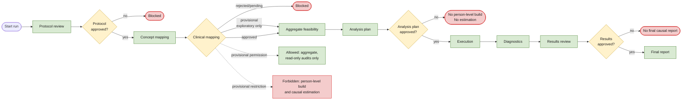
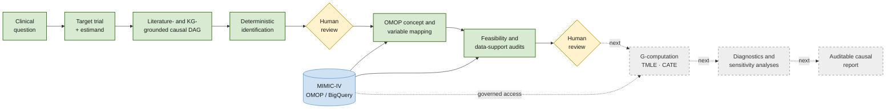

# CausalOMOP Project Diagrams

These diagrams describe the repository as of 28 July 2026. They deliberately
separate implemented components, prototypes or work in progress, external
systems, and planned causal-analysis components.

## Status legend

- Green: implemented; core causal and workflow behavior is covered by the root
  deterministic test suite.
- Orange: prototype, transitional implementation, or local work in progress.
- Blue: external system, database, or imported dependency.
- Grey dashed: planned component.

## Detailed end-to-end architecture

```mermaid
flowchart TB
    %% Entry points
    USER([Clinical researcher]):::external
    CLI["CausalOMOP CLI<br/>config · preflight · workflow · audits"]:::implemented
    NL["Natural-language<br/>clinical question"]:::input
    MANUAL["Reviewed protocol.json<br/>manual study specification"]:::input
    ROUTER{"Descriptive or<br/>causal request?"}:::planned

    USER --> NL
    USER --> MANUAL
    NL -. future routing .-> ROUTER
    ROUTER -. descriptive .-> FAST
    ROUTER -. causal .-> UQHS
    NL --> CLI
    MANUAL --> CLI

    %% Existing descriptive stack
    subgraph DESCRIPTIVE["Existing FastOMOP descriptive stack"]
        direction TB
        FAST["Agno FastOMOP<br/>semantic agent → database agent"]:::external
        OMCP_DESC["OMCP descriptive tools<br/>schema · concept lookup · SELECT"]:::external
        FOEM["FOEM<br/>evaluation and monitoring"]:::external
        FAST --> OMCP_DESC
        FAST --> FOEM
    end

    %% Evidence-grounded drafting
    subgraph DRAFTING["1–3. Question clarification and target-trial drafting"]
        direction TB
        UQHS["UserQuestionHypothesisService"]:::implemented
        LLMDEV["Development LLM<br/>OpenRouter / GPT-OSS"]:::external
        LLMPROD["Production LLM<br/>local OpenAI-compatible endpoint"]:::external
        PUBMED["PubMed E-utilities<br/>PMIDs + abstracts"]:::external
        OPTIMUSKG["OptimusKGClient<br/>biomedical knowledge-graph<br/>relation lookup"]:::implemented
        KGDATA["OptimusKG dataset<br/>~22M edges · cached in-process<br/>optional dependency"]:::external
        VALIDATE["Deterministic validation<br/>strict JSON · unchanged question<br/>required target-trial fields<br/>retrieved-citation allow-list<br/>(PMID/OpenAlex ∪ optimuskg: ids)"]:::implemented
        PRECHECK["Structural + clinical pre-check<br/>reuses assess_identification /<br/>assess_clinical_completeness early"]:::implemented
        CRITIQUE["Independent critique LLM call<br/>dag_critique.md · challenges the draft<br/>never emits DAG objects itself"]:::implemented
        REVISION["Bounded revision · ≤1 round<br/>same validation gate as the draft"]:::implemented
        PROTOCOL["protocol.json<br/>population · treatment · comparator<br/>time zero · grace period · outcome<br/>follow-up · estimands<br/>candidate_dag_unresolved"]:::artifact
        HYPOTHESIS["hypothesis.json<br/>normalized target trial<br/>effect modifiers · candidate DAG<br/>unresolved concept sets<br/>kg_evidence_id reinforcement"]:::artifact
        RAW["llm_outputs.json<br/>target_trial_draft · literature_dag_draft<br/>literature_dag_critique · literature_dag_revision"]:::artifact

        UQHS --> LLMDEV
        UQHS --> LLMPROD
        UQHS --> PUBMED
        UQHS -. "--skip-knowledge-graph" .-> OPTIMUSKG
        OPTIMUSKG --> KGDATA
        LLMDEV --> VALIDATE
        LLMPROD --> VALIDATE
        PUBMED --> VALIDATE
        OPTIMUSKG --> VALIDATE
        VALIDATE --> PRECHECK
        PRECHECK --> CRITIQUE
        CRITIQUE -. "verdict: revise" .-> REVISION
        CRITIQUE -. "verdict: approve /<br/>--skip-critique" .-> PROTOCOL
        REVISION --> PROTOCOL
        CRITIQUE --> RAW
        REVISION --> RAW
        VALIDATE --> HYPOTHESIS
        VALIDATE --> RAW
    end

    CLI --> UQHS
    CLI --> PROTOCOL

    %% Scientific causal core
    subgraph SCIENCE["4–5. Scientific causal design and identification — before OMOP mapping"]
        direction TB
        HYPAGENT["Hypothesis Agent<br/>normalizes protocol and candidate edges"]:::implemented
        DAGBRIDGE["DAG identification bridge<br/>clinical labels → general CausalDAG<br/>preserves PMID evidence"]:::wip
        CONTRACTS["CausalStudySpecification<br/>CausalQuestion + TargetTrialProtocol<br/>+ CausalEstimand + CausalDAG"]:::implemented
        DAGCHECKS["Deterministic DAG checks<br/>temporal order · cycles · descendants<br/>invalid mediator/collider adjustment"]:::implemented
        IDENTIFY["Identification engine<br/>backdoor graph · d-separation<br/>minimum adjustment sets<br/>explicit non-identification"]:::implemented
        DAGREVIEW{"Human review<br/>DAG and identification"}:::planned

        PROTOCOL --> HYPAGENT
        HYPOTHESIS --> HYPAGENT
        HYPAGENT --> DAGBRIDGE
        DAGBRIDGE --> CONTRACTS
        CONTRACTS --> DAGCHECKS
        DAGCHECKS --> IDENTIFY
        IDENTIFY -. normative gate .-> DAGREVIEW
    end

    %% Workflow state and governance
    subgraph GOVERNANCE["Persistent orchestration and governance"]
        direction LR
        WM["WorkflowManager<br/>filesystem-backed run state"]:::implemented
        STATE["state.json<br/>phase · history · artifact list"]:::artifact
        G1{"Protocol gate<br/>human reviewer"}:::implemented
        G2{"Clinical mapping gate<br/>approved or exploratory provisional"}:::implemented
        G3{"Analysis-plan gate<br/>human reviewer"}:::implemented
        G4{"Results gate<br/>human reviewer"}:::implemented
        READINESS["Execution Agent<br/>fail-closed authorization"]:::implemented
        CONTEXT["execution_readiness.json<br/>mcp_context.json<br/>hash + permissions"]:::artifact

        WM --> STATE
        G1 --> G2 --> G3 --> G4
        G2 --> READINESS
        G3 --> READINESS
        READINESS --> CONTEXT
    end

    CLI --> WM
    PROTOCOL --> WM
    HYPOTHESIS --> WM
    RAW --> WM
    HYPAGENT --> WM
    IDENTIFY -- "blocks protocol-gate approval<br/>if not identified by backdoor adjustment" --> WM
    WM --> G1

    %% OMOP operationalization
    subgraph MAPPING["6. OMOP operationalization"]
        direction TB
        DSAGENT["Data Science Agent<br/>phenotype and covariate plan"]:::implemented
        LOOKUP["Review-only concept candidates<br/>drug + condition lookup"]:::implemented
        PLAN["analysis_plan.json<br/>phenotypes · baseline windows<br/>covariates · blockers"]:::artifact
        REGISTRY["General DAG-node-to-OMOP registry<br/>concept sets · tables · fields<br/>windows · aggregation · missingness"]:::planned
        CLINREVIEW{"Human clinical mapping review"}:::implemented

        DSAGENT --> LOOKUP
        DSAGENT --> PLAN
        IDENTIFY -. approved required variables .-> REGISTRY
        LOOKUP --> CLINREVIEW
        PLAN --> CLINREVIEW
        REGISTRY -. future .-> CLINREVIEW
    end

    WM --> DSAGENT
    G1 --> DSAGENT
    CLINREVIEW --> G2

    %% Governed data access
    subgraph ACCESS["Governed OMOP data-access layer"]
        direction TB
        MCPCLIENT["CausalOMOP OMCP client"]:::implemented
        CAP["OMCP capabilities<br/>descriptive tools + causal operations"]:::wip
        CAUSALSELECT["Causal_Select_Query<br/>read-only · context required<br/>query SHA-256 · fail closed"]:::wip
        POLICY["Allowed operations<br/>aggregate_feasibility<br/>cohort_build · diagnostics<br/>causal_estimation"]:::wip
        DIRECT["Direct BigQuery gateway<br/>preflight · concept/source audits<br/>temporary equivalence path"]:::implemented
        QVAL["QueryValidationAgent<br/>allowed OMOP tables · no unbound params<br/>no SELECT * · no person_id leakage"]:::implemented

        MCPCLIENT --> CAP
        CAP --> CAUSALSELECT
        CONTEXT --> CAUSALSELECT
        POLICY --> CAUSALSELECT
    end

    LOOKUP --> MCPCLIENT
    READINESS --> MCPCLIENT

    %% Data platforms
    subgraph DATA["Data and ETL"]
        direction TB
        MIMICRAW["MIMIC-IV v2.2<br/>credentialed source data"]:::external
        OHDSI["OHDSI MIMIC ETL<br/>external submodule"]:::external
        BQ["BigQuery OMOP CDM<br/>runtime-configured restricted datasets"]:::external
        SNUHRAW["SYN-SNUH synthetic data"]:::external
        SNUHETL["SNUH ETL and vocabulary scripts<br/>drug · measurement · observation mapping<br/>concept-ancestor extension · validation"]:::implemented
        DUCK["Local curated DuckDB<br/>technical tests only"]:::external

        MIMICRAW --> OHDSI --> BQ
        SNUHRAW --> SNUHETL --> DUCK
    end

    OMCP_DESC --> BQ
    OMCP_DESC --> DUCK
    CAUSALSELECT --> BQ
    DIRECT --> QVAL --> BQ

    %% Feasibility and cohort planning
    subgraph FEASIBILITY["7. Data-support and feasibility audits"]
        direction TB
        CASE["Protocol-declared concept sets<br/>ConceptSetSpec: population · treatment<br/>comparator · outcome (any study)<br/>worked example: albumin/crystalloids vs<br/>crystalloids, adult ICU sepsis · 28-day mortality"]:::implemented
        COHORT["AnalyticCohortBuilder<br/>non-executable person-level SQL contract"]:::implemented
        FEAS["Aggregate feasibility<br/>eligibility and treatment-arm counts"]:::implemented
        PROFILE["Aggregate cohort profile<br/>rows · persons · treated · outcomes"]:::implemented
        FOLLOW["Follow-up observability audit<br/>observation_period · 28-day window"]:::implemented
        AUDITART["cohort_manifest.json<br/>feasibility.json<br/>cohort_profile.json<br/>followup_audit.json"]:::artifact

        CASE --> COHORT
        COHORT --> FEAS
        COHORT --> PROFILE
        COHORT --> FOLLOW
        FEAS --> AUDITART
        PROFILE --> AUDITART
        FOLLOW --> AUDITART
    end

    G2 --> COHORT
    MCPCLIENT --> FEAS
    MCPCLIENT --> PROFILE
    MCPCLIENT --> FOLLOW
    DIRECT --> FEAS

    %% Future analysis pipeline
    subgraph ANALYSIS["8–11. Statistical analysis and reporting"]
        direction TB
        OEST["Observed-data statistical estimand<br/>analysis plan and missing-data rules"]:::planned
        DATASET["Leakage-safe analytic dataset<br/>A · Y · index date · censoring<br/>baseline covariates · effect modifiers"]:::planned
        EST["Prespecified estimators<br/>g-computation · TMLE<br/>SuperLearner-style nuisance models<br/>ATE / ATT / CATE"]:::planned
        DIAG["Diagnostics<br/>positivity · overlap · balance<br/>model fit · missingness"]:::planned
        SENS["Sensitivity analyses<br/>negative controls · censoring variants<br/>unmeasured-confounding analysis"]:::planned
        FINALREPORT["Auditable causal report<br/>estimates + assumptions + limitations<br/>provenance + review decisions"]:::planned
        DEMO["demo_report.md<br/>technical and explicitly non-causal"]:::implemented

        OEST --> DATASET --> EST --> DIAG --> SENS --> FINALREPORT
    end

    AUDITART --> OEST
    G3 --> DATASET
    CONTEXT --> DATASET
    G4 --> FINALREPORT
    WM --> DEMO

    %% Test and traceability plane
    subgraph QUALITY["Cross-cutting quality and traceability"]
        TESTS["Deterministic root test suite<br/>220 tests passing"]:::implemented
        PROV["Artifact metadata<br/>agent/version/input hash"]:::implemented
        DOCS["Architecture, dataset, integration<br/>and responsible-demo documentation"]:::implemented
    end

    PROV --> HYPOTHESIS
    PROV --> PLAN
    PROV --> CONTEXT
    TESTS -. verifies .-> SCIENCE
    TESTS -. verifies .-> GOVERNANCE
    TESTS -. verifies .-> FEASIBILITY

    classDef implemented fill:#d9ead3,stroke:#38761d,color:#1b1b1b,stroke-width:1.5px;
    classDef wip fill:#fce5cd,stroke:#e69138,color:#1b1b1b,stroke-width:1.5px;
    classDef planned fill:#eeeeee,stroke:#777777,color:#333333,stroke-width:1.5px,stroke-dasharray:5 5;
    classDef external fill:#cfe2f3,stroke:#3d85c6,color:#1b1b1b,stroke-width:1.5px;
    classDef artifact fill:#fff2cc,stroke:#bf9000,color:#1b1b1b;
    classDef input fill:#ead1dc,stroke:#a64d79,color:#1b1b1b;
```

## Current workflow and human gates

This view shows the implemented filesystem workflow. The future normative
workflow will split the first gate into separate question/target-trial and
DAG/identification reviews.

## Presentation-friendly summary

Use this reduced diagram on a single slide. Reveal the blocks from left to
right if the presentation software supports animations.

## Suggested presentation explanation

> The workflow starts with the scientific question, not with the database. We
> first define the target trial and the counterfactual estimand. An LLM can help
> draft these artifacts and propose a literature-grounded DAG, but deterministic
> validation and human review control every scientific decision. Only after the
> effect has been identified do we map the required variables to OMOP and audit
> whether the data support the proposed study. OMCP provides governed, read-only
> access to the MIMIC-IV OMOP database. The current implementation reaches the
> feasibility and cohort-audit stages. Estimation with g-computation and TMLE,
> diagnostics, sensitivity analyses, and the final causal report are the next
> major development stages.
