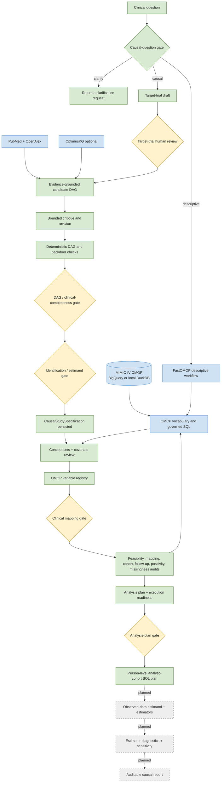
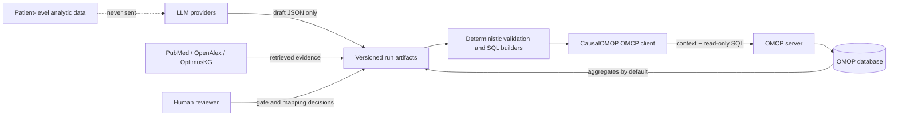

# CausalOMOP Architecture Diagrams

These diagrams reflect the maintained architecture. Green components are
implemented, yellow components require human review, blue components are
external, and dashed components are planned.

## End-to-end architecture

The descriptive branch is currently a redirect: the CLI and UI tell the user
to use FastOMOP but do not automatically transfer the request into the
FastOMOP process.

## Persistent workflow and gates

```mermaid
flowchart LR
    TR[target_trial_review] --> TG{target_trial gate}
    TG --> DR[dag_review]
    DR --> DG{dag_review gate}
    DG --> IR[identification_review]
    IR --> IG{identification_estimand gate}
    IG --> CM[concept_mapping]
    CM --> C{clinical_mapping gate}
    C --> F[feasibility]
    F --> AP[analysis_plan]
    AP --> A{analysis_plan gate}
    A --> E[execution]
    E --> D[diagnostics]
    D --> RR[results_review]
    RR --> R{results gate}
    R --> RP[report]

    IG -. approved .-> SPEC[study_specification.json persisted]
    C -. provisional exploratory .-> AGG[Aggregate audits only]
    A -. blocked .-> NOPERSON[No authorized person-level execution]

    classDef phase fill:#d9ead3,stroke:#38761d,color:#1b1b1b;
    classDef gate fill:#fff2cc,stroke:#bf9000,color:#1b1b1b;
    classDef block fill:#f4cccc,stroke:#cc0000,color:#1b1b1b;
    class TR,DR,IR,CM,F,AP,E,D,RR,RP,AGG,SPEC phase;
    class TG,DG,IG,C,A,R gate;
    class NOPERSON block;
```

The six current gates implement the governance split docs/causal_roadmap.md
used to propose as future work: separate review of the target trial
(`target_trial`), the DAG (`dag_review`), identification/estimand
(`identification_estimand`), and OMOP operationalization (`clinical_mapping`),
plus the pre-existing `analysis_plan`/`results` gates.

## Trust and data boundary

Raw LLM responses and run artifacts may contain the submitted clinical
question. Patient-level data must never be included in prompts. A generated
person-level cohort query is not authorization to export or share its result.

## Current boundary

CausalOMOP currently reaches governed study design, mapping, feasibility,
aggregate diagnostics, readiness assessment, and analytic-cohort SQL planning.
It does not yet implement treatment-effect estimation or a final causal report.
